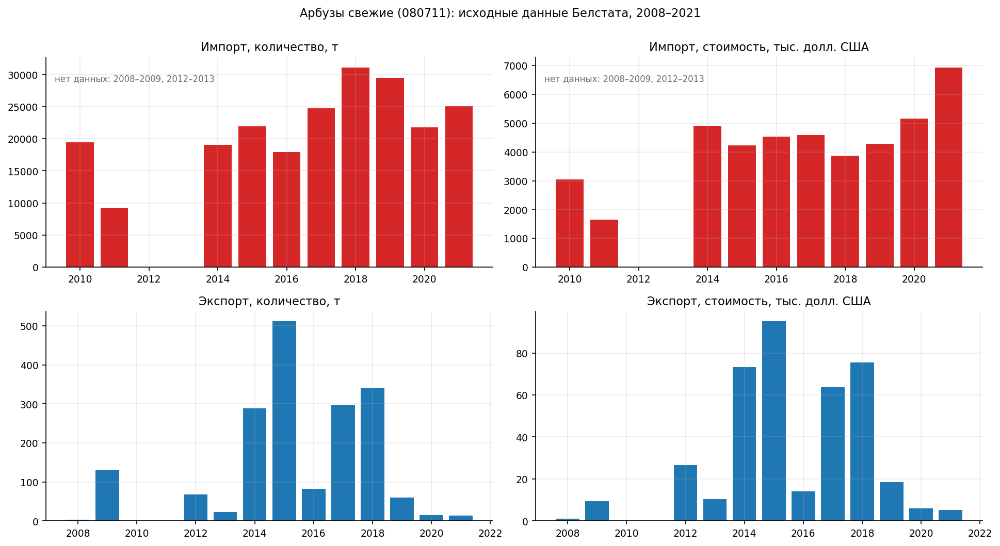
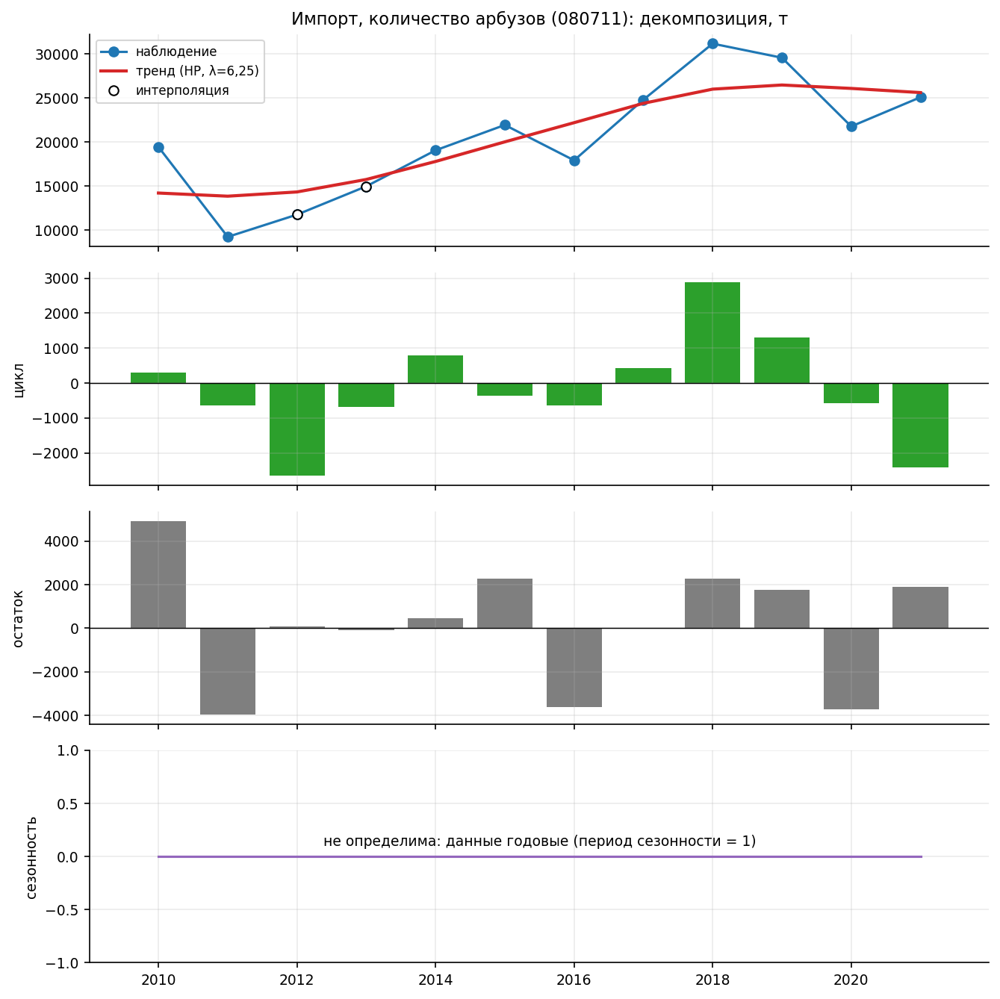
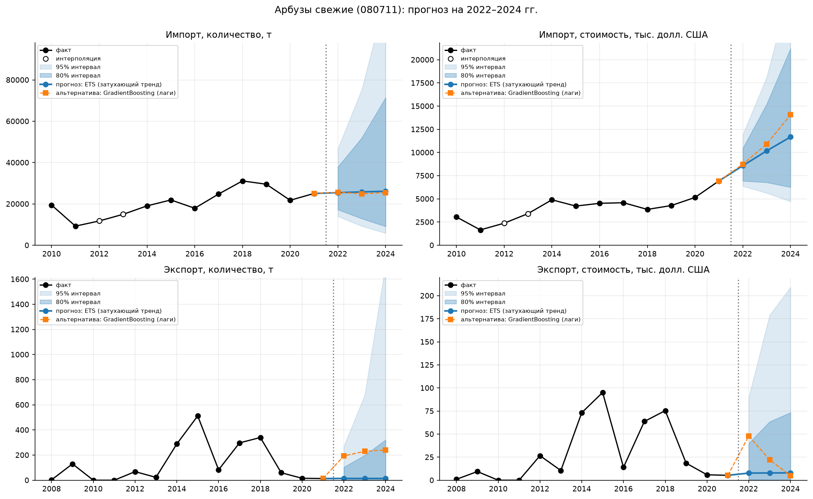
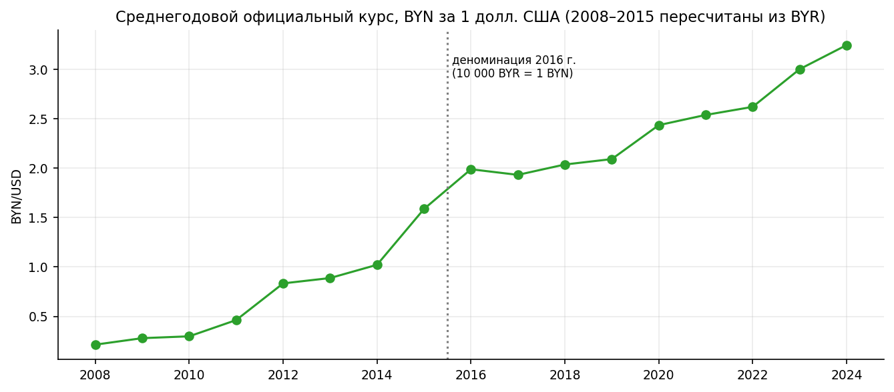
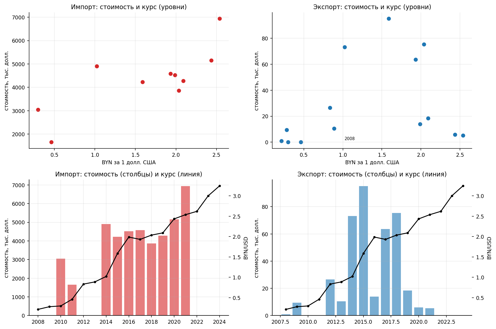

# Арбузы свежие (ТН ВЭД 080711): декомпозиция, прогноз 2022–2024 и связь с курсом BYN/USD

Источник: Национальный статистический комитет Республики Беларусь, «Экспорт и импорт товаров (6 знаков ТН ВЭД ЕАЭС)», раздел II «Продукты растительного происхождения». Год — календарный (январь–декабрь), единицы — тонны и тыс. долл. США.

Запуск: `pip install -r requirements.txt`, затем `python src/decompose.py`, `python src/forecast.py` (около 1–2 минут), `python src/fx_correlation.py`. Дополнительно (модели на внешних библиотеках): `pip install -r requirements-libs.txt` и `python src/forecast_libs.py` — см. раздел 6.

## 1. Данные и их ограничения

В исходных файлах — годовые итоги по две даты в файле, поэтому ряды годовые. Из 14 лет (2008–2021) данные собраны так:

| Годы | Экспорт | Импорт |
|---|---|---|
| 2008–2009 | `20089E.pdf` | **нет**: `20089I.pdf` оказался копией файла экспорта |
| 2010–2011 | `2010E.pdf` (строки 080711 нет, значит экспорт = 0) | `2010I.pdf` |
| 2012–2013 | `2012E.pdf` | **нет**: `2012I.pdf` — копия файла экспорта |
| 2014–2017 | `2014E.pdf`, `2016E.pdf` | `2014I.pdf`, `2016I.pdf` |
| 2018–2021 | `120E02*.xls` | `120I02*.xls` |

Итоговая таблица — `data/watermelon_080711_annual.csv` (с указанием файла-источника по каждому году). Значения 2017 года в PDF и xls совпадают.

Что из этого следует для анализа:
- **Экспорт** полный: 14 точек (2008–2021). В 2010–2011 годах он нулевой.
- **Импорт**: официальные данные есть за 10 лет (2010, 2011, 2014–2021). Ряд импорта для моделей начинается с 2010 года, пропуск 2012–2013 заполнен лог-линейной интерполяцией (на графиках отмечен пустыми кружками, при оценке моделей и корреляции эти точки не используются). Данных импорта за 2008–2009 нет, и я не восстанавливал их.
- **Сезонности в данных нет**: ряды годовые, период сезонности равен 1. Поэтому разложение содержит тренд, цикл и остаток, а сезонная компонента показана нулевой с пояснением. SARIMA с сезонной частью к таким данным неприменима.



## 2. Декомпозиция (тренд, цикл, остаток)

**Методика.** Тренд — фильтр Ходрика–Прескотта с λ = 6,25 (стандартное значение для годовых данных). Цикл — скользящая средняя за 3 года (центрированная) от отклонений от тренда. Остаток — то, что осталось. Сезонность — 0. Результаты в `results/decomposition.csv`, графики `charts/02_decomposition_*.png`.

**Результаты.** Доля дисперсии ряда, приходящаяся на тренд / цикл / остаток:

| Ряд | Тренд | Цикл | Остаток |
|---|---|---|---|
| Импорт, количество | 61% | 5% | 17% |
| Импорт, стоимость | 69% | 6% | 11% |
| Экспорт, количество | 36% | 6% | 39% |
| Экспорт, стоимость | 43% | 4% | 35% |

(доли не обязаны давать 100%: компоненты коррелируют друг с другом.)

**Интерпретация.**
- Тренд импорта в тоннах рос с ~14 тыс. т (2010) до максимума ~26,4 тыс. т в 2019 году и затем стабилизировался около 25,6 тыс. т. Тренд стоимости импорта ускоряется с 2018 года (с 4,6 до 6,1 млн долл. к 2021 году), хотя физический объём не растёт. Средняя цена импорта выросла со 157 долл./т (2010) и 124 долл./т (2018) до 277 долл./т (2021), то есть рост стоимости последних лет связан с ценой, а не с количеством.
- Экспорт нерегулярен: тренд достигает максимума в 2015–2016 годах (~266 т и ~56 тыс. долл.), а к 2021 году снижается почти до нуля (на краях ряда фильтр Ходрика–Прескотта менее надёжен, поэтому отрицательное значение тренда стоимости в 2008 году — артефакт метода). Остаток (разовые всплески вокруг тренда) объясняет около трети дисперсии, то есть это в большей степени случайные поставки, чем устойчивая динамика.
- Циклическая компонента мала везде (4–6% дисперсии): выраженных многолетних циклов в 12–14 точках выделить нельзя.

**Вывод по блоку.** Импорт описывается устойчивым трендом, экспорт — разрозненными всплесками на фоне почти нулевого уровня.



## 3. Прогноз на 2022–2024 годы

**Методика.** Для каждого из четырёх показателей (импорт и экспорт × количество и стоимость) обучены два подхода:
- **Статистический — ETS** (экспоненциальное сглаживание с аддитивным затухающим трендом Хольта), параметры α, β, φ подбираются минимизацией квадрата одношаговых ошибок. Реализован вручную (SciPy).
- **Машинное обучение — градиентный бустинг** (`GradientBoostingRegressor`, scikit-learn): предсказывает прирост логарифма ряда по признакам «уровень в предыдущем году» и «два последних прироста», прогноз строится рекурсивно.
- Для сравнения добавлен **наивный прогноз** («как в последнем наблюдении») — только как эталон, в выбор модели он не входит.

Ряды логарифмируются (`log1p`, так как в экспорте есть нули); прогнозы пересчитываются в исходные единицы и ограничиваются снизу нулём.

**Проверка качества.** Скользящая проверка с расширяющимся окном: модель обучается на данных до года *t* (минимум 6 лет) и прогнозирует год *t*. Для импорта получилось 6 проверочных лет (2016–2021), для экспорта 8 (2014–2021). Метрики считаются в исходных единицах: MAE, RMSE, MAPE (последняя — по ненулевым фактам). **Лучшая модель выбирается по RMSE** (она сильнее штрафует крупные промахи, а они важны при всплесках), результат в `results/model_metrics.csv`.

| Показатель | Модель | MAE | RMSE | MAPE, % |
|---|---|---|---|---|
| Импорт, т | **ETS** | 6 805 | **7 128** | 28,8 |
| | GradientBoosting | 6 537 | 8 117 | 29,6 |
| | наивный (эталон) | 4 982 | 5 437 | 20,8 |
| Импорт, тыс. долл. | **ETS** | 685 | **751** | 14,1 |
| | GradientBoosting | 941 | 1 194 | 17,8 |
| | наивный (эталон) | 692 | 887 | 13,2 |
| Экспорт, т | **ETS** | 216 | **335** | 304,9 |
| | GradientBoosting | 1 791 | 4 147 | 3 653,8 |
| | наивный (эталон) | 188 | 233 | 188,8 |
| Экспорт, тыс. долл. | **ETS** | 38,7 | **46,7** | 251,9 |
| | GradientBoosting | 97,3 | 159,3 | 1 345,8 |
| | наивный (эталон) | 37,2 | 46,1 | 164,2 |

**Выбор модели.** Для всех четырёх показателей по RMSE лучше ETS. Бустинг проигрывает у стоимости импорта и сильно проигрывает у экспорта: на 6–8 обучающих примерах он неустойчив, а ошибки на всплесках экспорта огромны. Только по MAE бустинг немного лучше в импорте в тоннах (6 537 против 6 805 т), но по RMSE он хуже. **Важная оговорка:** наивный прогноз сопоставим с ETS или лучше него у трёх показателей из четырёх (по RMSE наивный прогноз точнее ETS у импорта и экспорта в тоннах, практически равен ему у стоимости экспорта; ETS точнее только у стоимости импорта). То есть сложные модели почти не дают выигрыша над «как в прошлом году», и точность прогноза ограничена малым числом наблюдений.

**Прогноз лучшей модели (ETS), 2022–2024.** Интервалы получены моделированием 1 500 траекторий с гауссовыми ошибками в логарифмической шкале, σ — среднеквадратичная ошибка скользящей проверки; в исходной шкале они несимметричны. Полная таблица (включая бустинг) — `results/forecast_2022_2024.csv`.

| Показатель | Год | Прогноз | 80% интервал | 95% интервал |
|---|---|---|---|---|
| Импорт, т | 2022 | 25 453 | 17 231 – 37 912 | 13 971 – 46 769 |
| | 2023 | 25 826 | 12 866 – 51 975 | 9 223 – 75 325 |
| | 2024 | 26 128 | 9 092 – 71 465 | 5 831 – 120 175 |
| Импорт, тыс. долл. | 2022 | 8 577 | 6 931 – 10 451 | 6 363 – 11 925 |
| | 2023 | 10 179 | 6 775 – 15 210 | 5 629 – 18 094 |
| | 2024 | 11 673 | 6 251 – 21 206 | 4 713 – 27 962 |
| Экспорт, т | 2022 | 14,2 | 1,6 – 103,7 | 0,1 – 270,9 |
| | 2023 | 14,1 | 0,5 – 198,7 | 0,0 – 676,6 |
| | 2024 | 13,9 | 0,0 – 321,2 | 0,0 – 1 717,7 |
| Экспорт, тыс. долл. | 2022 | 7,7 | 0,7 – 40,0 | 0,0 – 89,9 |
| | 2023 | 7,9 | 0,2 – 63,5 | 0,0 – 178,9 |
| | 2024 | 8,0 | 0,1 – 73,4 | 0,0 – 209,2 |



**Интерпретация.**
- Импорт в тоннах прогнозируется на уровне последних лет (около 25–26 тыс. т), стоимость импорта — с продолжением роста 2021 года, до ~11,7 млн долл. к 2024 году (бустинг даёт ещё выше, ~14,1 млн долл.). Это продолжение ценового тренда, а не рост объёма.
- Экспорт прогнозируется на уровне 2020–2021 годов (около 14 т и 8 тыс. долл.). Интервалы очень широки: экспорт в прошлом был способен вырастать до 300–500 т, и модель не может исключить повторения.
- Широта интервалов — не ошибка расчёта, а отражение малого числа данных и нерегулярности экспорта. Точечные прогнозы для экспорта следует понимать как «около нуля с возможными всплесками».

**Вывод по блоку.** Лучшая из двух моделей — ETS, но точность по метрикам невысока и не лучше наивного эталона; прогноз пригоден как ориентир для импорта, а для экспорта — только как оценка порядка величин.

## 4. Курс BYN/USD и корреляция со стоимостью

**Данные.** Среднегодовой официальный курс белорусского рубля к доллару США (январь–декабрь, средняя геометрическая, как публикует Национальный банк), 2008–2024 годы: `data/usd_byn_annual.csv`. Курсы 2008–2015 годов заданы в старых белорусских рублях (BYR); в связи с деноминацией 1 июля 2016 года (10 000 BYR = 1 BYN) они разделены на 10 000, чтобы получить ряд в BYN. Источник: публикация Нацбанка на bii.by (ссылка внизу). Курс вырос с 0,21 BYN за доллар (2008) до 1,59 (2015), затем держался около 1,9–2,1 в 2016–2019 годах и поднялся до 3,25 в 2024 году.



**Методика.** Корреляция между стоимостью (тыс. долл. США) и курсом считается по годам, в которых есть фактические данные (экспорт 2008–2021, n = 14; импорт 2010, 2011, 2014–2021, n = 10; интерполированные годы не используются). Рассчитаны коэффициенты Пирсона и Спирмена: (а) по уровням и (б) по годовым изменениям логарифмов (логарифм берётся от `1+стоимость`, из-за нулей в экспорте), так как уровни оба растут во времени, и высокая корреляция уровней может быть следствием общего тренда. Изменения считаются только между соседними годами. Курсы 2022–2024 годов собраны, но в корреляции не участвуют, так как фактической стоимости за эти годы нет.

| Поток | Переменные | n | Пирсон r (p) | Спирмен ρ (p) |
|---|---|---|---|---|
| Импорт | уровни | 10 | 0,77 (0,010) | 0,66 (0,038) |
| Импорт | годовые изменения | 8 | −0,66 (0,075) | −0,43 (0,289) |
| Экспорт | уровни | 14 | 0,28 (0,337) | 0,34 (0,236) |
| Экспорт | годовые изменения | 13 | 0,45 (0,122) | 0,32 (0,289) |



**Интерпретация.**
- **Импорт, уровни:** умеренно сильная и статистически значимая положительная корреляция (r = 0,77), то есть при более высоком курсе доллара стоимость импорта выше. Но оба ряда растут во времени: переход к годовым изменениям убирает связь (r = −0,66 с p = 0,075, не значим на 5% уровне; для Спирмена p = 0,29). Значит, прямой зависимости нельзя утверждать: совпадение уровней, вероятно, обусловлено общим трендом (инфляция цен, рост курса).
- **Экспорт:** корреляции слабые и статистически незначимые при любой постановке (p > 0,1).
- Стоимость выражена в долларах США, поэтому механической зависимости от курса BYN/USD у неё нет; влияние курса возможно лишь косвенно (через спрос, цены, конкурентоспособность), и выборка из 8–14 точек не позволяет его выделить.

**Вывод по блоку.** Устойчивой статистической связи между стоимостью импорта или экспорта арбузов и курсом доллара не обнаружено; значимая корреляция уровней импорта объясняется общим трендом.

## 5. Итоговые выводы

1. **Данные.** Полный набор есть только для экспорта (2008–2021). Импорт доступен за 2010–2011 и 2014–2021 годы: файлы импорта за 2008–2009 и 2012–2013 не опубликованы (на сайте вместо них размещён экспорт). Пропуск 2012–2013 заполнен интерполяцией, 2008–2009 не восстанавливались. Данные годовые, поэтому сезонность отсутствует.
2. **Декомпозиция.** Импорт определяется трендом (61–69% дисперсии) с ростом до 2019 года и стабилизацией объёма; стоимость импорта растёт в последние годы за счёт цены (≈124 → 277 долл./т за 2018–2021). Экспорт — нерегулярные всплески (остаток объясняет 35–39%), цикл слаб.
3. **Прогноз.** Лучшая модель по RMSE — ETS (затухающий тренд) по всем четырём показателям; градиентный бустинг уступает, особенно в экспорте. Прогноз на 2024 год: импорт около 26 тыс. т и 11,7 млн долл., экспорт около 14 т и 8 тыс. долл. Интервалы широки, а наивный эталон сопоставим с ETS по точности, поэтому прогнозам следует доверять с осторожностью.
4. **Курс.** Значимая корреляция есть только у уровней стоимости импорта (r = 0,77) и объясняется общим трендом; по годовым изменениям и для экспорта устойчивой связи нет.

## 6. Модели на внешних библиотеках (ARIMA, XGBoost, LightGBM) — код не запускался

**Что сделано.** Скрипт `src/forecast_libs.py` добавляет три модели, которых не было в расчётах из-за отсутствия библиотек:
- **ARIMA** (`statsmodels`): порядок выбирается по AIC из (0,1,0), (1,1,0), (0,1,1) с дрейфом; сезонная часть не задаётся (сезонности в годовых данных нет), поэтому это ARIMA, а не SARIMA; интервалы 80% и 95% берутся из `statsmodels`;
- **XGBoost** и **LightGBM** — на тех же признаках, что бустинг из scikit-learn (уровень в предыдущем году и два последних прироста), интервалы строятся так же, как в разделе 3 (моделирование по ошибкам скользящей проверки).

Проверка качества, метрики и выбор лучшей модели те же, что в разделе 3. Prophet не реализован.

**Статус: код не запускался с настоящими библиотеками.** В среде разработки их нет, а интернета для установки нет. Я проверил только синтаксис и «обвязку» скрипта (загрузку данных, скользящую проверку, сбор таблиц и графика) на временных заглушках, которые имитировали интерфейсы библиотек; результаты этих проверок в репозиторий не попали. Поэтому **метрик и прогнозов этих моделей в репозитории нет**, и вывод о лучшей модели в разделе 3 сделан без них. Если при запуске возникнет ошибка (например, из-за версий библиотек), она проявится только у вас.

Как запустить:
```
pip install -r requirements.txt -r requirements-libs.txt
python src/forecast.py
python src/forecast_libs.py
```
Появятся `results/libs_model_metrics.csv`, `results/libs_forecast_2022_2024.csv`, `results/all_models_metrics.csv` (все модели вместе; лучшая — по RMSE, эталон не участвует) и график `charts/06_libs_forecasts.png`. После запуска выбор лучшей модели нужно перепроверить по `all_models_metrics.csv`.

**Нецелесообразность этих моделей на данных такого вида.** Модели из этого раздела применять к нашим рядам не рекомендуется, код добавлен лишь потому, что их использование предусмотрено условием:
- **Мало наблюдений.** В каждом ряду 10–14 годовых точек, а при скользящей проверке обучение идёт на 6–13 точках. Для ARIMA это слишком мало, чтобы устойчиво оценить параметры и выбирать порядок по AIC. Для XGBoost и LightGBM после построения лагов остаётся 3–10 обучающих строк, тогда как такие модели рассчитаны на сотни и тысячи примеров; настройка гиперпараметров на таком объёме невозможна.
- **Нет сезонности.** Данные годовые, период сезонности равен 1, поэтому сезонная часть SARIMA и годовая/недельная сезонность Prophet не имеют смысла; без неё SARIMA сводится к обычной ARIMA, а Prophet — к кусочно-линейному тренду с шумом.
- **Деревья не экстраполируют.** Ансамбли деревьев (XGBoost, LightGBM, бустинг из scikit-learn) не умеют продолжать тренд за пределы наблюдавшихся значений, а мы прогнозируем именно рост (стоимость импорта).
- **Нерегулярность экспорта.** Экспорт — редкие всплески от 0 до 512 т; любая из этих моделей на таком ряду либо повторяет последний уровень, либо даёт неустойчивые результаты. В наших расчётах бустинг из scikit-learn уже проиграл ETS и наивному прогнозу, особенно по экспорту (раздел 3), и нет оснований ждать иного от XGBoost и LightGBM.
- **Что подошло бы больше.** Помесячные или поквартальные ряды (не менее 5–6 лет, то есть 60+ точек) — тогда сезонность, SARIMA и Prophet становятся осмысленными; на годовых рядах из 10–14 точек разумнее простые методы (наивный, ETS) и экспертная оценка.

## Источник курсов

Средний официальный курс белорусского рубля по отношению к иностранным валютам (Национальный банк Республики Беларусь), публикация на bii.by: https://bii.by/docs/srednij-ofitsialnyj-kurs-belorusskogo-rublya-po-otnosheniyu-k-inostrannym-valyutam-235604
